# Serverless Image Processing Pipeline on AWS

Upload an image in the browser. A few seconds later it has been validated, resized into a
thumbnail and a web-size copy, watermarked, tagged by Amazon Rekognition, captioned by a
model on Amazon Bedrock, recorded in DynamoDB, and served through CloudFront. You get
an email either way.

Everything is serverless and pay-per-use: with no traffic the stack costs close to nothing,
and the whole thing is created and destroyed with Terraform.

This is my graduation project for the Manara course "AWS 2: Becoming a Solutions Architect"
(SAA-C03 preparation), Project 2: Serverless Image Processing Pipeline with S3, SQS and Lambda.
The AI tagging and captioning step is my own addition.

- Live demo: https://dqy4z0thnvewm.cloudfront.net
- Demo video: _link added after recording_

The caption model is a Terraform variable (`bedrock_model_id`). The default is Claude Haiku 5.5
(`us.anthropic.claude-haiku-5-5`). The live demo runs Amazon Nova Lite
(`us.amazon.nova-lite-v1:0`) because Anthropic model access is still pending on the demo
account. The code is the same for both, because it uses the model-agnostic Bedrock Converse API.

## Contents

- [Architecture](#architecture)
- [How it works](#how-it-works)
- [Services used and why](#services-used-and-why)
- [Design decisions and trade-offs](#design-decisions-and-trade-offs)
- [Reliability and failure handling](#reliability-and-failure-handling)
- [Security](#security)
- [Mapping to the course learning outcomes](#mapping-to-the-course-learning-outcomes)
- [Cost estimate](#cost-estimate)
- [Deploy](#deploy)
- [Test](#test)
- [Tear down](#tear-down)
- [Repository layout](#repository-layout)
- [Screenshots](#screenshots)
- [What I would add for production](#what-i-would-add-for-production)

## Architecture

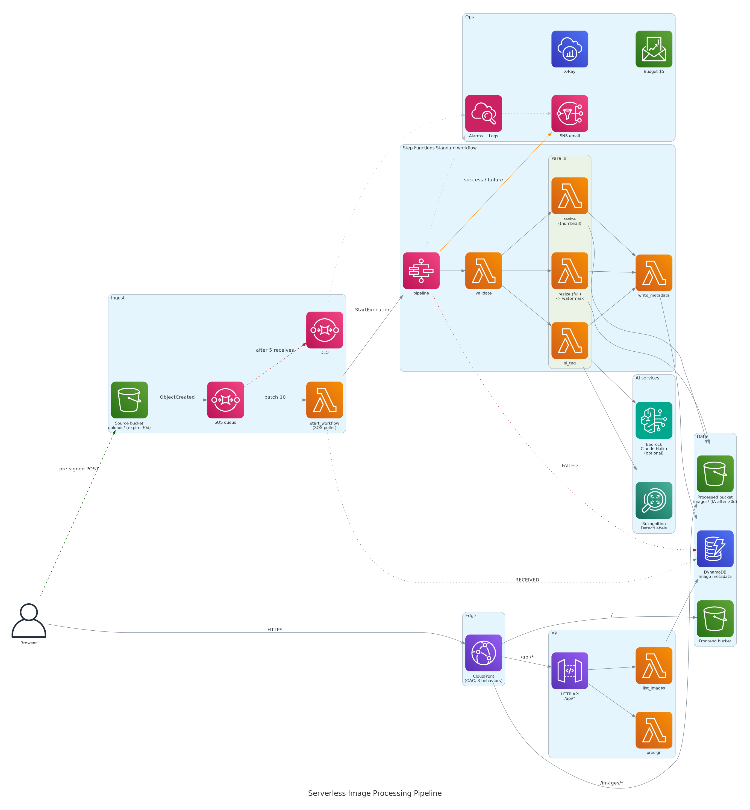

The diagram is generated from code: [`docs/diagram.py`](docs/diagram.py) uses the Python
`diagrams` library with the official AWS icons.

**Editable draw.io version.** The same architecture laid out by path (request path, event
path, workflow, data stores, operations):
[open it in draw.io](https://app.diagrams.net/#Uhttps%3A%2F%2Fraw.githubusercontent.com%2Fy-emam%2Faws-serverless-image-pipeline%2Fmain%2Fdocs%2Farchitecture.drawio)
or download [`docs/architecture.drawio`](docs/architecture.drawio). It is also generated from
code ([`docs/drawio.py`](docs/drawio.py)).

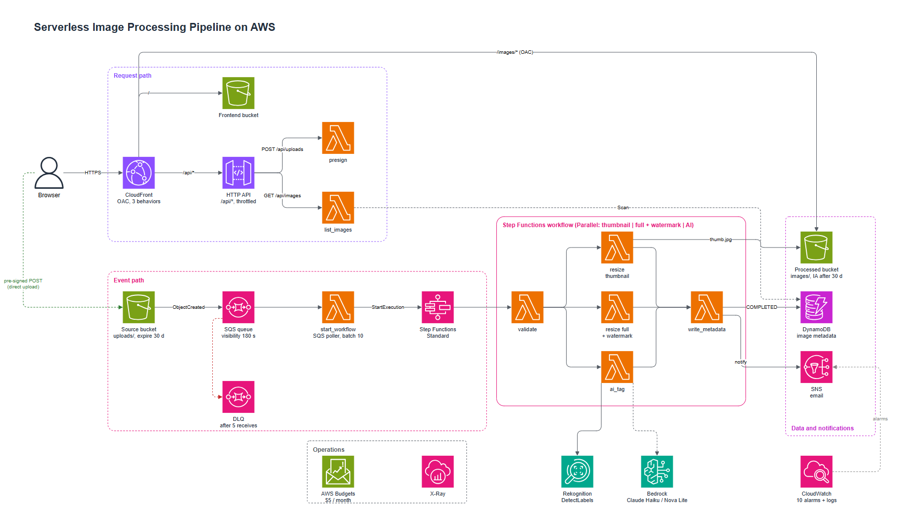

## How it works

1. **Get an upload URL.** The page calls `POST /api/uploads` on CloudFront, which forwards it
   to an API Gateway HTTP API. The `presign` Lambda returns an S3 pre-signed POST. The POST's
   policy only allows one exact key (`uploads/<id>.<ext>`), one content type (JPEG, PNG or WebP),
   files of at most 10 MB, and expires after 5 minutes.
2. **Upload straight to S3.** The browser sends the file directly to the private source bucket.
   The file never passes through API Gateway or Lambda, which avoids API Gateway's 10 MB request
   limit and means we don't pay Lambda time for copying bytes.
3. **S3 event to SQS.** The bucket sends an `ObjectCreated` notification for the `uploads/`
   prefix to an SQS queue. The queue has a dead-letter queue (DLQ) behind it.
4. **A Lambda polls the queue.** The `start_workflow` function receives up to 10 messages per
   invocation through an event source mapping. For each image it:
   - skips S3 test events and keys that are not images
   - writes a `RECEIVED` row to DynamoDB
   - starts one Step Functions execution, named after the image and the S3 event sequencer, so
     a duplicate S3 event cannot start a second run

   If one message fails, only that message is returned to SQS (`ReportBatchItemFailures`).
5. **The workflow runs** (Step Functions Standard). This diagram is generated from the
   state machine definition by [`docs/workflow_diagram.py`](docs/workflow_diagram.py):

   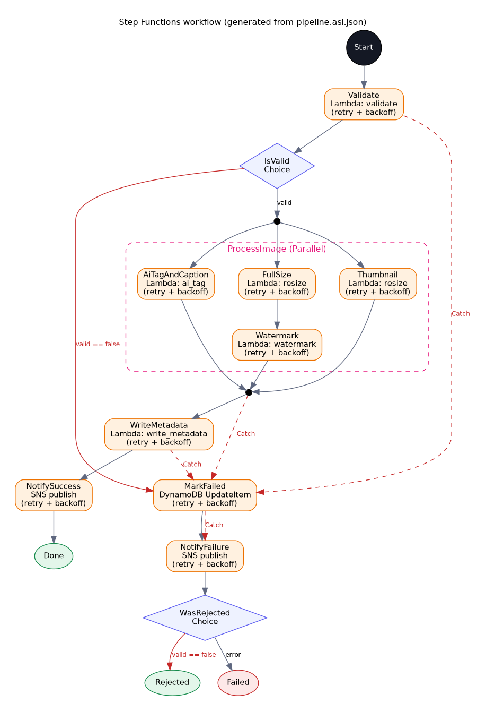

   1. `validate` reads the file and checks the real format with Pillow, not the file
      extension. It also checks size and pixel count (decompression-bomb guard). A bad image is
      marked `FAILED` with the reason.
   2. Three branches then run in parallel:
      - `resize` writes a 320 px thumbnail.
      - `resize` writes a 1600 px copy to a private `staging/` prefix. `watermark` stamps it and
        publishes it under `images/`, so an un-watermarked copy is never public.
      - `ai_tag` sends a downscaled copy to Rekognition `DetectLabels` for tags. It also asks
        Bedrock (through the Converse API) for one sentence of alt text.
   3. `write_metadata` writes the `COMPLETED` record: dimensions, tags, caption and output keys.
   4. SNS emails a summary with the CloudFront links.
6. **On any failure,** the workflow marks the row `FAILED` directly through the Step Functions
   DynamoDB integration (no extra Lambda) and emails the error. A rejected upload (a bad file)
   then ends in a `Succeed` state called `Rejected`, because the system worked as designed.
   Real errors end in `Fail`, so the "workflow failed" alarm only fires for those.
7. **Serving.** One CloudFront distribution has three behaviors:
   - `/` serves the static site from the frontend bucket.
   - `/images/*` serves the processed bucket through Origin Access Control.
   - `/api/*` goes to the HTTP API, uncached.

   Both buckets are private. Only this distribution can read them.
8. **Lifecycle.** Raw uploads are deleted after 30 days. Processed images larger than 128 KB move
   to S3 Standard-IA after 30 days. Leftover staging files are deleted after 1 day.

## Services used and why

| Service | Role here | Why this and not the alternative |
|---|---|---|
| Amazon S3 | Source, processed and frontend buckets | Durable, cheap object storage with event notifications and lifecycle rules built in. |
| S3 pre-signed POST | Browser uploads | The browser uploads directly to a private bucket with no AWS credentials. A POST policy can enforce size and type on the S3 side, which a pre-signed PUT cannot. |
| Amazon SQS + DLQ | Buffer between S3 and processing | Decouples upload from processing. Absorbs bursts, retries automatically, and parks poison messages in the DLQ. S3 can also invoke Lambda directly, but then there is no buffer and no redrive. |
| AWS Lambda | All compute | Pay per millisecond, no servers, scales to zero. arm64 (Graviton) is about 20% cheaper than x86. |
| Lambda layer | Pillow | Large native dependency packaged once and shared by four functions. It is built from manylinux wheels for arm64, so it imports on Lambda even though it is built on Windows. |
| AWS Step Functions (Standard) | Orchestration | Retries, error catching, parallel branches and a visual execution history, with no orchestration code to write. Standard, not Express: Standard runs each execution name exactly once (the duplicate-event protection relies on that) and keeps 90 days of execution history for debugging. Express is cheaper for high volume, but it is at-least-once and limited to 5 minutes per run. |
| Amazon Rekognition | Image labels | Managed computer vision: one API call, no model to host. |
| Amazon Bedrock | Captions (Claude Haiku 5.5 by default, Nova Lite on the demo account) | Managed access to foundation models, billed per token. The Converse API makes the model a configuration value. Optional: switch it off with `enable_bedrock = false`. |
| Amazon DynamoDB | Image metadata | Key-value lookups by image id, on-demand billing, nothing to manage. RDS would bill by the hour even when idle. |
| Amazon API Gateway (HTTP API) | Upload and gallery API | About 70% cheaper and faster than a REST API. We need none of the REST-only features (API keys, usage plans, request validation). |
| Amazon CloudFront + OAC | Serves site, images and API | Edge caching and HTTPS, buckets stay private, one domain for everything (no CORS for the API). OAC is the current replacement for the older Origin Access Identity. |
| Amazon SNS | Email on success and failure, alarm notifications | Simple fan-out to email. Step Functions publishes to it directly, without a Lambda. |
| Amazon CloudWatch | Logs, 10 alarms | DLQ depth, errors per Lambda, failed executions. 10 standard alarms fit the free tier. |
| AWS X-Ray | Tracing | Shows time spent per step across Lambda and Step Functions. Effectively free at this volume. |
| AWS Budgets | $5 monthly budget alert | Created before anything else, so a mistake shows up in the inbox, not on the bill. |
| Terraform | Infrastructure as code | The plan shows every change before it happens. Teardown is one command. It is the most requested IaC tool in job posts. |

## Design decisions and trade-offs

**A Lambda consumer polls the queue (not EventBridge Pipes).** The brief asks for a Lambda
function that polls the queue. EventBridge Pipes can connect SQS to Step Functions with no code,
but the Lambda gives us three things the Pipe does not:
- a `RECEIVED` row in DynamoDB
- deterministic execution names for deduplication
- per-message failure reporting

**Step Functions orchestrates; Lambdas stay small.** Each function does one job and has its
own IAM role. The workflow handles retries and failures. A single "do everything" Lambda would
be simpler to deploy, but one failure would redo all the work, and every permission would be
merged into one role.

**Parallel branches.** The thumbnail, the full-size copy and the AI step only need the
original, so they run at the same time. The brief lists the steps in order; running them in
parallel gives the same result in roughly the time of the slowest branch.

**Visibility timeout = 6 x Lambda timeout (180 s).** When the consumer receives a message, SQS
hides it for the visibility timeout. If the function has not deleted it by then, SQS assumes the
consumer failed and shows the message again. If the timeout were shorter than the function's
run time, a second invocation would receive a message the first one is still processing. AWS
recommends at least 6 times the function timeout for SQS event sources, which leaves room for
batching and retries. `maxReceiveCount` is 5, so a message has to fail five times before it
moves to the DLQ.

**Idempotency.** S3 delivers events at least once, so duplicates must be harmless:
- The execution name is `<image_id>-<S3 sequencer>`. A duplicate event gets the same name, and
  Step Functions rejects it.
- The `RECEIVED` write is conditional, so it never overwrites a later status.
- `write_metadata` uses a full `PutItem`, so a re-run rewrites the same row.
- `MarkFailed` will not overwrite a `COMPLETED` row.

**Bad images are data, not exceptions.** `validate` returns `valid: false` with a reason
instead of raising. The workflow records that reason in DynamoDB. Exceptions are kept for
problems where a retry can help.

**Standard-IA only above 128 KB.** Standard-IA charges every object as at least 128 KB and has
a 30-day minimum. Thumbnails are usually smaller than that and would cost more in IA. The
transition rule uses an object-size filter so only the larger images move. Since September 2024
S3 also applies a 128 KB minimum to transitions by default (visible in the lifecycle screenshot);
the explicit filter keeps the intent in the code instead of relying on that default.

**Bedrock is optional and cannot break the pipeline.** Model access needs a one-time setup per
account. If Bedrock returns an error, the image is still processed and simply has no caption.
`enable_bedrock = false` removes the call and its IAM permission completely.

**No login.** The brief does not ask for user accounts, and a sign-up wall would get in the way
of anyone trying the demo. Abuse is limited by layers instead:
- API Gateway throttling (5 requests per second, burst 10)
- the pre-signed POST policy (one file, image types only, 10 MB, 5 minutes)
- the validate step
- lifecycle expiry of raw uploads
- the budget alert and alarms

See [What I would add for production](#what-i-would-add-for-production).

**One CloudFront distribution.** The site, the images and the API share one domain. The API
needs no CORS, there is one certificate, and one place to add WAF later. The only cross-origin
call is the browser's upload POST to S3, which is allowed by the bucket's CORS rule for the
CloudFront domain only.

## Reliability and failure handling

| What fails | What happens |
|---|---|
| Lambda service error or throttle in any step | Step Functions retries up to 3 times with exponential backoff and jitter |
| Rekognition throttling | The `ai_tag` step retries with longer backoff |
| Bedrock error or no model access | Image completes without a caption; reason stored in `caption_source` |
| Not an image, wrong format, too big, too many pixels | Row marked `FAILED` with the reason, failure email; the execution ends in `Rejected` (Succeed), so no alarm |
| Any other error in the workflow | `Catch` -> row marked `FAILED` (unless already `COMPLETED`) -> failure email |
| The consumer cannot start a workflow | The message returns to SQS; after 5 receives it goes to the DLQ -> `dlq-not-empty` alarm email |
| Duplicate S3 event | Same execution name -> Step Functions rejects the duplicate -> treated as success |

Alarms (all email through SNS):
- DLQ not empty
- errors for each of the 8 Lambda functions
- any failed Step Functions execution

## Security

- **Private buckets:**
  - All three buckets have Block Public Access on and ACLs disabled.
  - Bucket policies deny any request that is not over TLS.
  - CloudFront reads only `images/*` and the site, through OAC, with a condition on this
    distribution's ARN.
- **Least privilege:** one IAM role per function, scoped to exact resources:
  - `presign` can only `PutObject` under `uploads/`.
  - `watermark` can only read and delete under `staging/` and write under `images/`.
  - The consumer can only use its queue, start this one state machine and put rows in this
    one table.
  - Rekognition and X-Ray use `*` only because those APIs don't support resource-level
    permissions.
- **Confused-deputy protection:** the S3-to-SQS queue policy and the service trust policies
  check `aws:SourceArn` / `aws:SourceAccount`.
- **Image hygiene:**
  - EXIF metadata (including GPS location) is stripped from every output.
  - EXIF rotation is applied before stripping, so the image still displays the right way up.
  - The decompression-bomb limit stops tiny files that expand into huge images.
- **No secrets in the repo:** the email, the AWS profile and the account ID come from a
  gitignored `terraform.tfvars` or from AWS at plan time. Only `terraform.tfvars.example` is
  committed.
- **Browser output:** the frontend writes all API data with `textContent`, never `innerHTML`.

## Mapping to the course learning outcomes

| Learning outcome (from the brief) | Where it shows up |
|---|---|
| Design event-driven architectures using S3 event notifications and SQS | `infra/storage.tf` (notification on `uploads/`), `infra/queue.tf` (queue, DLQ, queue policy), `infra/consumer.tf` (event source mapping) |
| Understand why SQS decoupling improves resilience and enables retries | Upload and processing are independent: bursts wait in the queue, failed hand-offs are retried by SQS, poison messages end in the DLQ. Visibility timeout sizing explained above. |
| Use Lambda Layers to package large dependencies | `scripts/build_layer.py` builds Pillow for arm64 from manylinux wheels; `infra/lambda.tf` publishes it and attaches it to the 4 image functions |
| Orchestrate multi-step serverless workflows with Step Functions | `infra/statemachine/pipeline.asl.json`: Choice, Parallel, Retry with backoff and jitter, Catch, and direct SNS and DynamoDB integrations |
| Apply S3 lifecycle policies to transition or expire objects by storage class | `infra/storage.tf`: expire raw uploads (30 days), move processed images over 128 KB to Standard-IA (30 days), expire staging leftovers (1 day), abort incomplete multipart uploads |
| Serve processed content through CloudFront with appropriate cache behaviors | `infra/cdn.tf`: `/images/*` cached long (immutable keys, `Cache-Control: max-age=31536000, immutable`), site with a 5 minute TTL, `/api/*` not cached; OAC; `PriceClass_100` |

## Cost estimate

Rough monthly cost in us-east-1 for 1,000 images a month. These are list prices from the time
of writing; check the [AWS Pricing Calculator](https://calculator.aws/) for current numbers.
Free-tier credits on a new account cover most of this.

| Service | Usage | Approx. cost |
|---|---|---|
| Lambda (arm64) | about 5 GB-seconds per image, 5,000 GB-s total | under $0.10 |
| Step Functions Standard | about 12 state transitions per image | about $0.30 |
| Rekognition DetectLabels | 1,000 images | about $1.00 |
| Bedrock caption (Claude Haiku 5.5 or Nova Lite) | about 1,000 input + 40 output tokens per image | about $0.15 or less |
| S3, DynamoDB, SQS, SNS, API Gateway, CloudFront | small volumes | under $0.20 |
| CloudWatch alarms (10) and X-Ray | inside the free tier | $0 |
| **Total** | | **about $1.75 per 1,000 images** |

**Idle cost is close to $0.** There is no NAT Gateway, EC2, RDS or anything else billed by the
hour. What's left is storage (a few MB) and CloudWatch Logs retention (14 days). Rekognition is
the largest variable cost; turning off Bedrock saves very little.

## Deploy

Prerequisites:
- an AWS account
- an AWS CLI profile with admin rights for setup
- Terraform 1.9 or later
- Python 3.12 or later

Docker is optional.

1. **Build the Pillow layer** (once, and again after changing its version):

       python scripts/build_layer.py

2. **Create your variables file** (gitignored) and set `aws_profile` and `alert_email`:

       cp infra/terraform.tfvars.example infra/terraform.tfvars        (Windows cmd: copy infra	erraform.tfvars.example infra	erraform.tfvars)

3. **Create the budget alert first:**

       terraform -chdir=infra init
       terraform -chdir=infra apply -target=aws_budgets_budget.monthly

4. **Review the plan, then deploy everything.** CloudFront takes a few minutes.

       terraform -chdir=infra plan -out=deploy.tfplan
       terraform -chdir=infra apply deploy.tfplan

5. **Confirm the SNS subscription** from the email AWS sends you. Until you do, no
   notifications arrive.
6. **Optional, for captions:** in the Bedrock console (us-east-1), open the chat playground
   once, choose Claude Haiku, and send any prompt. Anthropic models need a one-time use-case form
   per account. Until that is done, images are processed without captions. If your account cannot
   get Anthropic access, set `bedrock_model_id = "us.amazon.nova-lite-v1:0"` and apply again.
7. **Open the site:**

       terraform -chdir=infra output site_url

## Test

**Unit tests** cover all 8 handlers with `moto` and botocore `Stubber`, using generated test
images (a rotated JPEG, a transparent PNG, a small WebP, a GIF and a text file named `.jpg`).
They run offline with fake credentials:

    python -m venv .venv
    .venv/Scripts/pip install -r requirements-dev.txt      (Linux/macOS: .venv/bin/pip)
    .venv/Scripts/python -m pytest

**End-to-end test** against the deployed stack:

    AWS_PROFILE=<your profile> python tests/e2e/e2e_test.py                  (bash)
    $env:AWS_PROFILE="<your profile>"; python tests/e2e/e2e_test.py         (PowerShell)

It uploads a real image and checks:
- the row reaches `COMPLETED` with tags
- the rotation was applied
- both images are served by CloudFront
- the processed bucket returns 403 when accessed directly
- the gallery API lists the image

It then uploads a text file disguised as a JPEG and checks that it ends as `FAILED` /
`InvalidImage`. Last run against the deployed stack: all checks passed, 13 seconds from upload
to `COMPLETED`.

**Frontend preview without deploying:** `scripts/dev_server.py` serves `frontend/` on
http://localhost:8000 and proxies `/api` and `/images` to the deployed CloudFront URL:

    python scripts/dev_server.py https://<your-distribution>.cloudfront.net

## Tear down

One command removes everything, including the objects in the buckets (`force_destroy`):

    terraform -chdir=infra destroy

The CloudWatch log groups and the budget are managed by Terraform too, so nothing is left
behind.

## Repository layout

    infra/                  Terraform (one file per concern) and the state machine definition
      statemachine/         pipeline.asl.json (Amazon States Language)
    src/functions/<name>/   one folder per Lambda, handler in app.py
    src/layers/pillow/      layer requirements
    scripts/build_layer.py  builds the Pillow layer for the Lambda architecture
    scripts/dev_server.py   local frontend preview against the deployed API
    frontend/               static site (HTML, CSS, JS)
    tests/unit/             pytest + moto
    tests/e2e/              end-to-end test against a deployed stack
    tests/images/           test images and the script that generates them
    docs/                   architecture diagram (code, PNG, draw.io), workflow diagram
                            (generated from the ASL), demo script, screenshots

## Screenshots

All taken from the live demo. Captions come from Amazon Nova Lite on Bedrock, tags from Amazon
Rekognition. Demo photos are from [Unsplash](https://unsplash.com) (Unsplash License).

**Upload page and gallery**

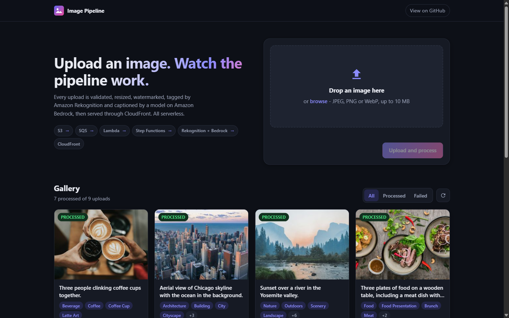

**Gallery: processed images with captions and tags, and rejected uploads**

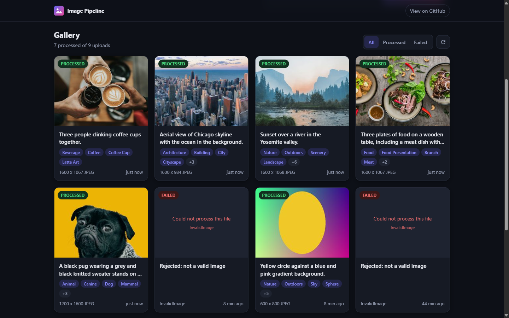

**Full-size viewer: watermarked web copy, AI caption, Rekognition tags**

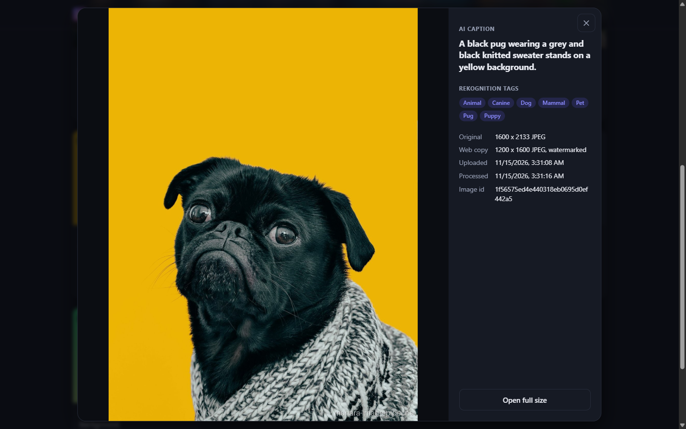

**Phone layout**

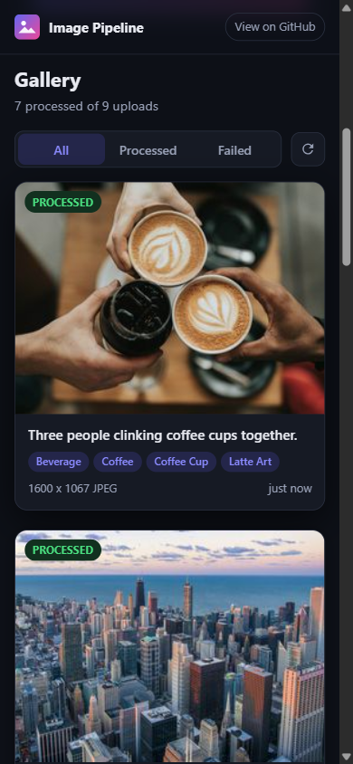

**Step Functions: a successful execution, with the output of the AI step (Rekognition labels)**

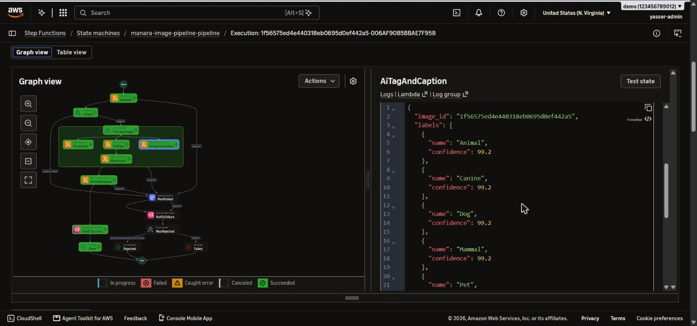

**DynamoDB: the metadata record for one image**

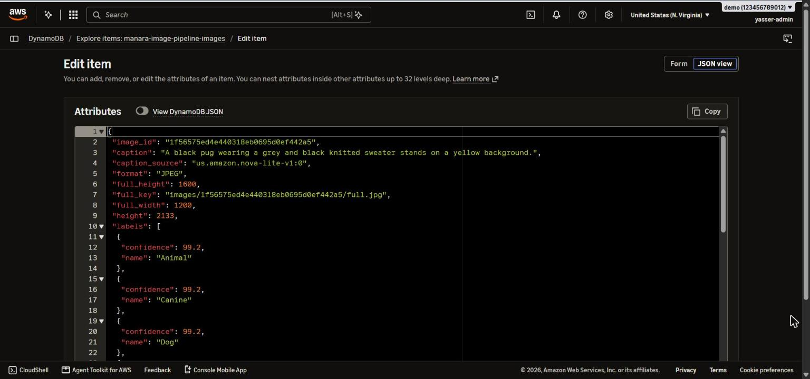

**CloudWatch: the 10 alarms, all OK**

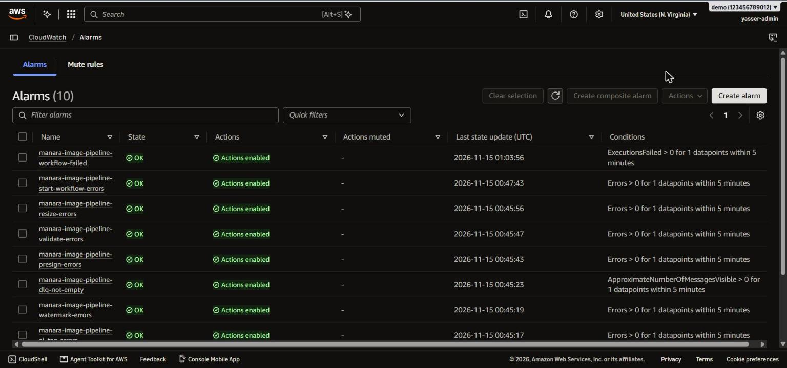

**SNS: the success email (one per processed image)**

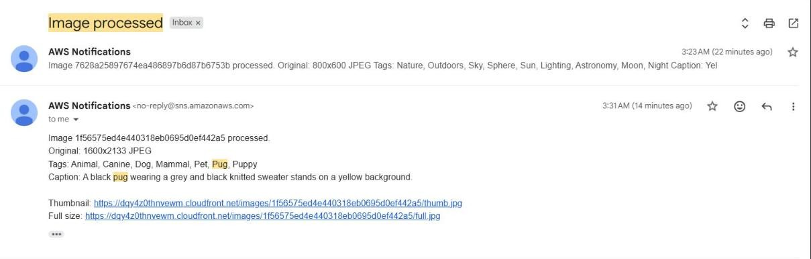

**S3: lifecycle rules on the processed bucket**

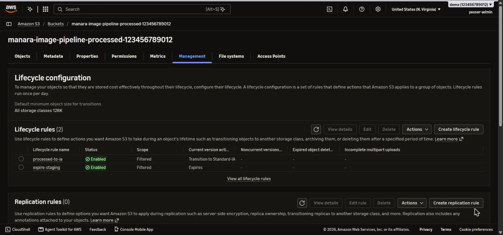

The account id in the console screenshots is replaced with a placeholder.

## What I would add for production

- **User accounts:** Amazon Cognito user pool, a JWT authorizer on the HTTP API, and uploads
  keyed by user id (`uploads/<user>/<image>`) with per-user quotas.
- **Edge protection:** AWS WAF on CloudFront with a rate-based rule and bot control. It's left
  out of the demo because it costs about $5-6 a month even when idle.
- **Gallery query:** a DynamoDB GSI (`status`, `uploaded_at`) so the gallery queries instead
  of scanning.
- **Custom domain:** ACM certificate and Route 53 alias.
- **Remote Terraform state:** an S3 backend with state locking and a CI pipeline that runs
  `plan` on pull requests.
- **Content moderation:** Rekognition `DetectModerationLabels` before an image is published.
